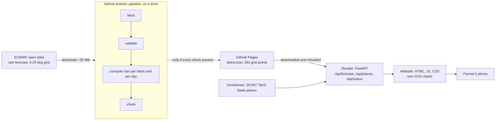

# Vaanam: rain forecast for Tamil Nadu

## What it does

- Shows how much rain is expected, day by day for the next 10 days, for any village or town in Tamil Nadu.
- Built for **small farmers**: one search box, plain sentences, colours from yellow to red as rain increases.
- **Rain only, no farming advice.** Farming decisions are the farmer's to make.
- **What makes it different:** it is very simple. Official and commercial weather apps hold far more but take effort
  to read. Vaanam answers one question clearly: *how much rain, when, near me?*

## Try it

**https://rain-forecast-api-qii4.onrender.com**

- **The first visit may take 30–60 s.** The free server sleeps after 15 minutes without visitors and has to wake up
  (the page says so).
- Searches to try:
  - a town: `Thanjavur`
  - a nickname or old name: `Ooty`, `Tanjore` (finds Thanjavur)
  - a misspelling: `Madurei` (asks "Did you mean Madurai?")
  - or tap **Use my location** (shows the nearest place name, never coordinates)
- Tap a day to see when the rain is expected (3- or 6-hour blocks).
- Swagger: https://rain-forecast-api-qii4.onrender.com/docs

## Why I built it

- **The problem:** weather apps are detailed but hard to interpret. Maps, symbols and percentages stand between a
  farmer and a simple answer.
- **My choices:**
  - **Rain only:** one variable, explained well.
  - **Plain sentences:** "Light rain expected, mostly in the afternoon." Each one gives the amount, IMD's word for it
    and a colour.
  - **No farming advice:** the farmer knows their crop and field; the app only describes the rain.
  - **Village search by name**, tolerant of nicknames and spelling mistakes. Farmers do not know coordinates.
  - **Honest about uncertainty:**
    - every forecast says it is an area average;
    - missing data shows as "no data", never 0;
    - a forecast older than 36 hours carries a warning;
    - tiny amounts show as "< 0.1 mm", not "0.0".
  - **Colours are not warnings:** the page links to IMD for official warnings.
  - **Light:** 53 KB including fonts, nothing loaded from other sites. That suits slow connections and protects privacy.

## How it works



- **Pipeline** (`pipeline/`): checks every downloaded field, computes rain, publishes. Any failure means nothing is
  published and the last good forecast stays live.
- **API** (`api/app.py`): matches a place to the nearest grid point and adds the IMD category and sentence. It also
  serves the website (`web/`, no framework, no chart library).
- **Why this split:** free, and the heavy pipeline stays apart from the site.

## How the rain numbers are made

1. **Running totals:** ECMWF gives rain *since the forecast started*. These come every 3 hours up to 144 hours ahead,
   then every 6 hours up to 258 hours.
2. **Rain per block:** the later total minus the earlier one. The app never claims when, within a block, the rain falls.
3. **Daily totals:** the blocks summed from **23:30 to 23:30 IST**.
   - Midnight IST is never a forecast time.
   - 23:30 IST (18 UTC) exists for all 10 days.
   - Alternatives: a 05:30 boundary would move early-morning rain to the previous date, and IMD's 08:30 boundary
     disappears after day 6.
   - The first day is partial and labelled "18 hours".
4. **Tiny negative values:** stored numbers are rounded, so a block can dip a hair below zero.
   - The original data is never changed.
   - A dip within the rounding error, worked out from the data's own precision, is shown as 0 mm and logged.
   - A larger dip blocks publication, and the previous forecast stays.
5. **IMD categories** (mm per 24 h; IMD *SOP Weather Forecasting and Warning Services 2021*, Table 1.5):

   | Very light | Light | Moderate | Heavy | Very heavy | Extremely heavy |
   |---|---|---|---|---|---|
   | ≤ 2.4 | 2.5–15.5 | 15.6–64.4 | 64.5–115.5 | 115.6–204.4 | ≥ 204.5 |

   The category is applied to the rounded number shown, so the word always matches the number.

Details: [docs/DAILY_RAINFALL_ANALYSIS.md](docs/DAILY_RAINFALL_ANALYSIS.md),
[docs/inspection/imd_rain_categories_20261113.txt](docs/inspection/imd_rain_categories_20261113.txt).

## Key decisions

All 37 decisions, with alternatives and evidence: [docs/DECISIONS.md](docs/DECISIONS.md).

- **Rain only, no advice** (D-026).
- **23:30 IST day, 10 full days plus today** (D-006). Going to 258 hours, slightly beyond the usual 240, gains a
  10th full day.
- **Never publish a doubtful forecast** (D-008, D-015). The negative tolerance allows for rounding in both readings, a
  wider choice than the one suggested to me.
- **IMD's own categories, cited**, not invented ones (D-027).
- **Search with "did you mean"** (D-024). A few wrong suggestions are better than finding nothing.
- **Free, split hosting** (D-021): pipeline on GitHub, site on Render.

## Testing

- **333 automated tests** (pytest), each written before its code. They cover:
  - rain arithmetic;
  - corrupt and incomplete downloads;
  - publishing;
  - search and spelling;
  - the API;
  - the page (texts, colour contrast, no farming words, page weight);
  - this README.
- **Real data:** our download matched an independent manual download byte for byte. The API returns every published
  value unchanged ([scripts/smoke_test.py](scripts/smoke_test.py)).
- **Failure drill:** a deliberately corrupt download was rejected and the live forecast stayed the same.
- **Swagger** (`/docs`): endpoints tried by hand; wrong inputs give clear errors (outside Tamil Nadu: 404).
- **Browser:** phone size (360 × 780) and laptop size: searches, location messages, no sideways scrolling, no errors.
- **Real phone:** tested on my own phone.
- **Load test** on the live site ([results](docs/inspection/loadtest_20261113.txt)): 35 people at once, about 225
  visits a minute, **0 errors**, 95 % of requests under 5.7 s. Breaking point not reached.

## Keeping it up to date: a timer runs the pipeline

- **How it runs now:** cron-job.org starts the pipeline every hour at 5 past, through GitHub's API (D-035).
  GitHub's own timer stays as a backup ([.github/workflows/pipeline.yml](.github/workflows/pipeline.yml)).
- **Fresh forecasts, automatically:**
  - ECMWF's new forecast is ready around 07:30–08:00 UTC.
  - The next hourly run (08:05 UTC, 13:35 IST) downloads, checks and publishes it, every day, with no one pressing
    anything.
  - Every other run finds nothing new and stops.
- **Honestly: how we got here.**
  - **Plan:** GitHub's built-in timer. On 13 Nov none of its timed runs started, although every setting was correct.
    GitHub does not say why.
  - **Option A**, switching the workflow off and on to re-register the timer: **did not work**.
  - **Option B**, new times away from GitHub's busiest minutes, 7 a day: **did not work**. The next two slots were
    missed too, and the only timed run that ever came was 1 h 41 min late (D-033, D-036).
  - A manual run kept the forecast current in the meantime.
  - **Option C**, the last resort: an outside timer (cron-job.org). It was kept for extreme cases because it needs a
    GitHub key stored elsewhere. With the deadline near, we used it. The key can only start workflows in this
    repository and expires on 31 Jan 2027.
  - **Result:**
    - test run accepted (204) and successful on 13 Nov;
    - on 14 Nov the 08:05 UTC run published the new forecast **on its own**, live at 08:07 UTC (D-036).

## Limitations

- An **area average** about 27 km wide. One field can get very different rain, and local extremes are underestimated
  (ECMWF documents this).
- One model, one run a day, no probability of rain. The forecast can be up to about 31 hours old.
- English only. Place names follow GeoNames, and some small villages are missing.
- Free server: the first visit after a quiet spell is slow, and more than 35 users at once is untested.
- Updates depend on cron-job.org and on a GitHub key that must be renewed before 31 Jan 2027. If either fails,
  cron-job.org emails a warning, and the site shows its 36-hour warning.
- One missing forecast step skips the whole update (the last one stays live). Partial publishing is deferred (D-019).
- Not yet tested on slow rural mobile networks. The JavaScript has no unit tests of its own.

## What next

- **Every village in Tamil Nadu:** add an official village list (e.g. the Census village directory) to GeoNames.
- **All of India:** the region is already a setting (`config/`), and IMD categories are national. The cost is a larger
  forecast file and a paid server.
- Tamil language, a second daily update (12 UTC run), and tests on slow rural networks.

## Run it locally

```powershell
py -3.12 -m venv .venv; .\.venv\Scripts\python.exe -m pip install -r requirements-dev.txt
.\.venv\Scripts\python.exe -m pytest
$env:FORECAST_URL="https://basumrittika810-arch.github.io/rain-forecast/latest.json"
.\.venv\Scripts\python.exe -m uvicorn api.app:app --port 8000   # then open http://127.0.0.1:8000
```

## Credits

- Forecast data: **ECMWF** open data (IFS HRES), CC BY 4.0.
- Place names: **GeoNames**, CC BY 4.0.
- Rain categories: **India Meteorological Department**, SOP Weather Forecasting and Warning Services, 2021.
- Fonts: Baloo 2 (Ek Type) and Arima (NDISCOVER), SIL Open Font License (`web/fonts/`).
- Built by Mrittika Basu, with Claude Code as coding assistant.
